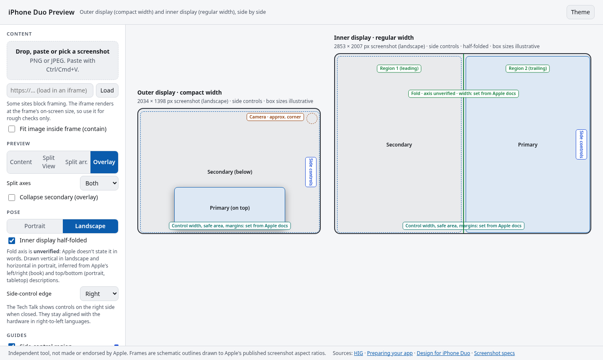

# iphone-duo-design

An agent skill and toolkit for building iOS apps that work well on **iPhone Duo**, across the compact outer display and the large inner one. It covers:
- size classes and resizable layouts
- bars that move to the side
- keeping interactive elements clear of the fold (reserved regions)
- split views and arrangement views, sheets, Split View multitasking, and games

Everything here is grounded in Apple's own pages: the [Designing for iPhone Duo HIG](https://developer.apple.com/design/human-interface-guidelines/designing-for-iphone-duo), [Preparing your app for iPhone Duo](https://developer.apple.com/documentation/technologyoverviews/preparing-your-app-for-iphone-duo), the [Design for iPhone Duo Tech Talk](https://developer.apple.com/videos/play/tech-talks/111466/), and the Apple pages they link to. [`references/sources.md`](references/sources.md) lists each source and which claims are verified or still unverified.

> Independent project by belweave. Not made or endorsed by Apple. "iPhone" and "iPhone Duo" are Apple trademarks.

## What's inside

| Path | What it's for |
|---|---|
| [`SKILL.md`](SKILL.md) | The skill entry point: principles, checklist, and a routing table that points the agent to the right tool or file for each task |
| [`scripts/duo-lint`](scripts/duo-lint) | A dependency-free Swift scanner (Python 3 stdlib). It flags `UIScreen.main`, fixed widths, orientation and idiom layout, custom bars, `ignoresSafeArea` on controls, symmetric insets, odd grid columns, manually placed controls that ignore reserved regions, custom ellipsis menus, title-only toolbar items, fixed bar spacers, and arrangements nested in scroll views. It prints `file:line`, the rule, and the fix |
| [`tests/`](tests) | `unittest` suite for `duo-lint`, with good and bad Swift fixtures (`python3 -m unittest discover -s tests`) |
| [`templates/swiftui/`](templates/swiftui) | SwiftUI templates: size-class root, split-view collapse, split and overlay arrangements, fold-aware controls and grid, single-button sheet opt-out, game fill, vertical bar organization, and the preview matrix (`DuoPreviewMatrix.swift`) |
| [`templates/uikit/`](templates/uikit) | UIKit equivalents of the templates above (no preview matrix) |
| [`tools/duo-preview.html`](tools/duo-preview.html) | Offline visual previewer. It drops a screenshot into outer and inner display frames at Apple's screenshot aspect ratios, with portrait and landscape, a half-folded overlay, side-control and safe-area guides, a 50/50 Split View, and split and overlay arrangement diagrams |
| [`references/hig-summary.md`](references/hig-summary.md) | Condensed Apple guidance with a source tag on every point |
| [`references/api-index.md`](references/api-index.md) | Every API this skill names, linked to its Apple doc page |
| [`references/patterns.md`](references/patterns.md) | Layout patterns mapped to templates |
| [`references/migration-guide.md`](references/migration-guide.md) | A step-by-step migration of an existing app |
| [`references/test-plan.md`](references/test-plan.md) | A pose-by-pose test plan for the Device Hub simulator or a device |
| [`references/review-rubric.md`](references/review-rubric.md) | A scored review rubric with ship bar and report template |
| [`references/design-review-checklist.md`](references/design-review-checklist.md) | Designer pre-ship checklist (the rubric scores its sections) |
| [`references/sources.md`](references/sources.md) | Apple sources and the claim ledger (verified, corrected, unverified) |
| [`prompts/review-screen.md`](prompts/review-screen.md) | Copy-paste prompt for an agent reviewing a screen with the linter, rubric and test plan |
| [`.claude-plugin/`](.claude-plugin) | Claude Code plugin manifest and marketplace file |
| [`install/`](install) | `AGENTS.md` snippet (Codex and Cursor) and a Cursor project rule |
| [`evals/`](evals) | Behavior evals and trigger evals for the skill |
| [`docs/images/`](docs/images) | Screenshots of the preview tool |

## Install

Each method below was checked against the agent's current official docs on 2026-10-17. The doc links are listed with each method.

### Claude Code: plugin marketplace
This repository is a Claude Code marketplace (`.claude-plugin/marketplace.json`) containing one plugin (`.claude-plugin/plugin.json`, with `SKILL.md` at the plugin root).

```sh
claude plugin marketplace add Belweave/iphone-duo-design
claude plugin install iphone-duo-design@belweave
```
Inside a session, `/plugin marketplace add Belweave/iphone-duo-design` does the same thing. Docs: [Create a marketplace](https://code.claude.com/docs/en/plugin-marketplaces) and [Plugin manifest reference](https://code.claude.com/docs/en/plugins-reference). The manifests pass `claude plugin validate .`.

### Claude Code: plain skill folder
```sh
git clone https://github.com/Belweave/iphone-duo-design.git ~/.claude/skills/iphone-duo-design
```
Use `.claude/skills/iphone-duo-design` instead for a single project. Docs: [Skills](https://code.claude.com/docs/en/skills).

### Cursor
Cursor loads skills from `.agents/skills/`, `.cursor/skills/`, `~/.agents/skills/` and `~/.cursor/skills/`, and also from `~/.claude/skills/` and `~/.codex/skills/`. The folder name must match the skill `name`.
```sh
git clone https://github.com/Belweave/iphone-duo-design.git ~/.cursor/skills/iphone-duo-design
```
You can also add project instructions in one of two ways:
- Copy [`install/cursor/iphone-duo-design.mdc`](install/cursor/iphone-duo-design.mdc) into `.cursor/rules/`. Project rules must use the `.mdc` extension.
- Paste [`install/AGENTS.md`](install/AGENTS.md) into your `AGENTS.md`.

Docs: [Agent Skills](https://cursor.com/docs/context/skills) and [Rules / AGENTS.md](https://cursor.com/docs/context/rules).

### OpenAI Codex
Codex reads skills from `.agents/skills` (in the repo, from your working directory up to the repo root) and from `$HOME/.agents/skills`.
```sh
git clone https://github.com/Belweave/iphone-duo-design.git ~/.agents/skills/iphone-duo-design
```
Mention it with `$iphone-duo-design`, or let Codex pick it from the description. To make it standing project guidance, paste [`install/AGENTS.md`](install/AGENTS.md) into your repo's `AGENTS.md`. Docs: [Build skills](https://developers.openai.com/codex/skills) and [AGENTS.md](https://developers.openai.com/codex/guides/agents-md).

### `npx skills` (the open agent skills CLI)
```sh
npx skills add Belweave/iphone-duo-design            # project install, pick agents interactively
npx skills add Belweave/iphone-duo-design -g -a claude-code -a codex -a cursor -y
```
The CLI discovers a `SKILL.md` at the repository root and also reads `.claude-plugin/` manifests. Docs: [vercel-labs/skills](https://github.com/vercel-labs/skills) (npm package `skills`). In our check, version 1.7.2 wouldn't start on Node.js 20, so use a current Node.js release.

## Quick start

```sh
# Lint a project (exit code 1 on warnings/errors; --strict also fails on info)
scripts/duo-lint path/to/YourApp
scripts/duo-lint path/to/YourApp --format json > duo-lint.json
scripts/duo-lint --list-rules

# Run the linter's tests
python3 -m unittest discover -s tests -v
```
To suppress a finding, add `// duo-lint:disable=DUO002` on the line or the line above it, or `// duo-lint:disable-file=DUO008` anywhere in the file. `duo-lint` is a line-based heuristic, not a compiler, so confirm each finding.

## Design helpers

Two helpers for reviewing designs, both independent and not made or endorsed by Apple.

### `tools/duo-preview.html`
A single offline HTML file with no dependencies. Open it in any modern browser.

- **Content:** Drop, paste, or pick a screenshot, or load a URL in an iframe. The screenshot appears in an **outer display** frame (compact width) and an **inner display** frame (regular width). Both are drawn at one shared scale using the aspect ratios of Apple's [published screenshot sizes](https://developer.apple.com/help/app-store-connect/reference/app-information/screenshot-specifications): 1398 × 2034 px outer and 2007 × 2853 px inner, verified on 2026-10-17. It warns you if the image doesn't match.
- **Pose:** Switch between portrait and landscape, turn on a **half-folded** overlay that marks the fold and its two regions on the inner display, and choose the side-control edge. The fold's axis (vertical in landscape, horizontal in portrait) is **labeled unverified**, because Apple implies it but never states it in words.
- **Guides:** Show the side-control region, safe area, layout margins, and the outer camera corner.
- **Previews:** A 50/50 **Split View** with controls on each app's outer edge, plus diagrams of the **split arrangement** and the **overlay arrangement**, both flat and folded.
- **Values:** Apple doesn't publish inset, margin, control width, or fold width numbers. Those fields start empty, marked "set from Apple docs", and are saved locally once you fill them in.
- Dark and light themes. You can deep-link a state, for example `duo-preview.html#theme=light&orient=landscape&fold=1&mode=arrO`.



For code-level previews, `templates/swiftui/DuoPreviewMatrix.swift` renders a view under each size-class configuration Apple names. It doesn't invent display sizes. The fold, cameras and vertical bars only appear in the Device Hub simulator.

### `references/design-review-checklist.md`
A short pre-ship checklist covering size classes, vertical controls, the fold and reserved regions, arrangements, sheets, Split View, and review assets. Each section links back to Apple's source pages, and [`review-rubric.md`](references/review-rubric.md) scores it.

## License

MIT
